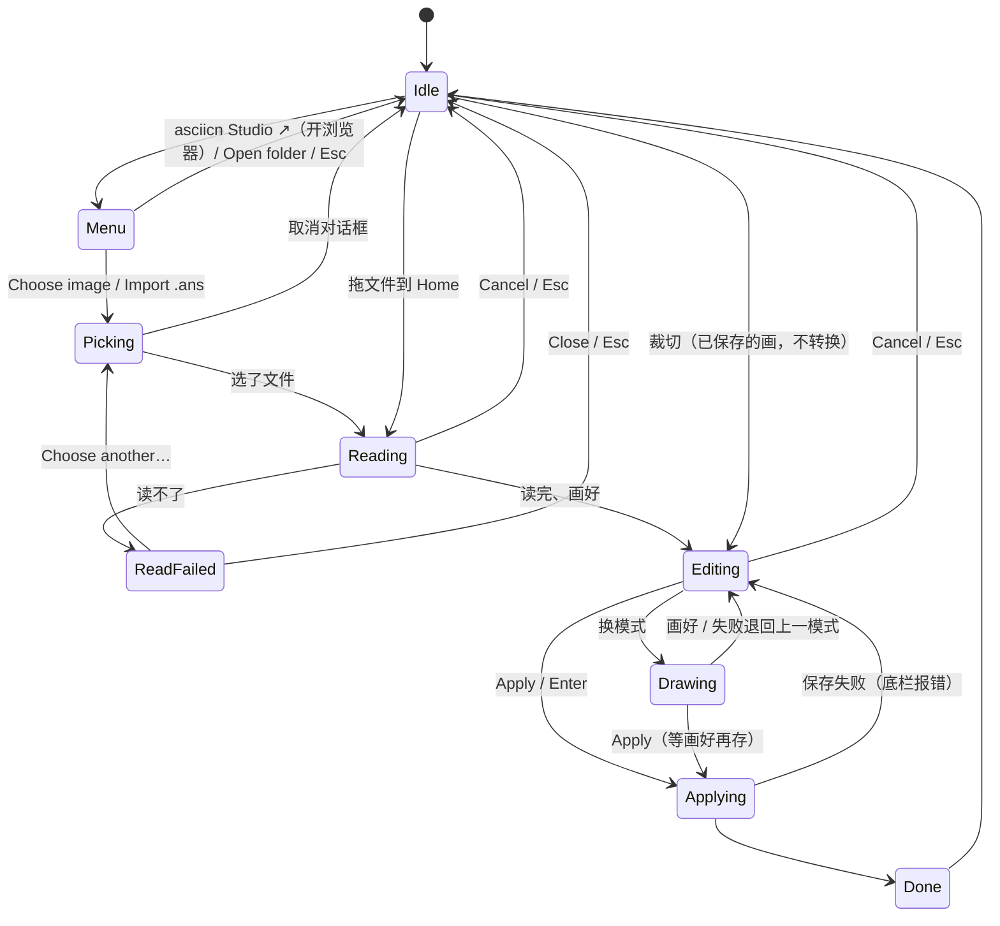

# 壁纸创建流程重设计（2026-11-14）

线框图：[wallpaper-create-redesign.html](wallpaper-create-redesign.html)，每个状态一帧，另有状态转换图和缩放示意。本文只写决策点、交互规格和要改的代码范围。基线是 `rewrite/wallpaper` 的 `4586dc3d`。

设计原则 P1–P9 见 [design-audit.md](design-audit.md)，已定事项见 [decisions.md](decisions.md)「设计」一节。

**状态：已拍板（2026-11-14）**。7 点全部采用建议项，已在 `rewrite/wallpaper` 实施，见文末「实施记录」。捏合只写了向 Herdr 提 `on_pinch` 的需求草稿 [herdr-on-pinch-request.md](herdr-on-pinch-request.md)，没有对外提交。

## 现状为什么别扭

- **三张卡、两层跳转**。`+` 打开添加卡，卡里有 5 个动作和 2 句说明。点 *Create in asciicn Studio…* 会换成第二张卡（三步说明，再加一个 *Import* 和 *Back*）。选好文件后，又换成第三张预览卡。Import 这个动作在前两张卡里各出现一次。
- **禁用的东西太多**。预览时切换器里 ‹ › + 裁切 × 全部禁用；内置画的裁切和 × 永远禁用；`.ans` 的模式行整行禁用；Reset 平时也是禁用的。
- **状态没有自己的位置**。读取、转换、保存、出错，全挤在一个 60px 的说明区里，平时那里放着两句说明。读取中整张预览卡已经出现，但所有控件都不能用。
- **缩放只能拖滑杆**。滚轮和触控板都不起作用，滑杆是 1–4 的线性刻度。

## 新流程一句话

`+` 是一个原生菜单，也可以把文件直接拖到 Home 上。选好文件后，右下角的切换器原地变成一张**取景卡**：先只显示名字和进度，读完再向上展开出控件，底部那行按钮的位置自始至终不动。保存成功后卡片收起，切换器显示新画的名字。



## 决策（已拍板（2026-11-14）：每条都取第一个选项，即建议项）

1. **入口**
   - **（建议）`+` 改成原生菜单，Home 也接受拖入文件。** 菜单有四项：*Choose image…*、*Import Studio file (.ans)…*、*asciicn Studio ↗*（第二行写「Export .ans there, then drop it here」）、*Open wallpaper folder*。添加卡和 Studio 卡都删掉。`+` 用共享的触发按钮（P6），提示的第二行写「Or drop an image or .ans on Home」。理由：一次点击就能选来源。Studio 本来就只是「打开网页，回来导入」两步，用菜单里的一项加一行提示就讲完了。拖入（`on_drop`）在 Windows 上也能用，正好补上 Windows 没有文件对话框的缺口。
   - 保留添加卡，只删说明文字和 Studio 卡：改动小，但选来源仍要经过一张卡。
2. **取景卡的位置和形状**
   - **（建议）右下角一张卡，编辑期间占住切换器的位置，宽 300。** 从上往下依次是：名字、模式、Fill/Fit + Reset、Zoom、底栏（状态槽 \| Cancel \| Apply）。按决策「标题、名字、模式、取景、按钮」的顺序排，名字本身就是标题，所以删掉「Preview wallpaper」这行。高度从 352 降到 208，`.ans` 和已保存的画是 168。
   - 底部居中的横向工具条：遮挡更少，但 Home 窄于约 640 时要折成两行，而且和决策定下的竖向顺序不一致。
3. **滚轮和触控板怎么对应缩放、平移**
   - **（建议）带刻度的滚轮缩放；触控板双指平移；⌘ 或 Ctrl 加任意滚动也缩放。** 缩放都以指针为中心。判别依据是宿主给不给 `delta_lines`（见下方「宿主能力」）。理由：鼠标用户没有双指，用滚轮缩放最顺手；触控板用户平移最自然；捏合拿不到，用 ⌘ 加双指滚动来代替。
   - 所有滚动都缩放，平移只靠拖动：规则最简单，但触控板上双指一动画面就缩放，容易误触。
   - 滚动一律平移，只有加 ⌘ 才缩放（Figma 的默认做法）：最一致，但鼠标用户每次缩放都要按 ⌘。
4. **内置画能不能取景，删除放在哪**
   - **（建议）所有画都能取景；删除挪进取景卡底栏左侧的「Delete…」，只有导入的画才出现。** 切换器变成 `‹ name › ⌗ +`，没有禁用的槽。内置画的构图也写进 `placements` 表，键用它自己的 id。理由：内置画的裁切和 × 永远是禁用的，这本身就是一种占位；删除是低频操作，放进对单张画的编辑里正合适。
   - 维持现状：内置画的裁切和 × 保持禁用。
5. **读取中和读取失败的样子**
   - **（建议）卡片先只显示名字、进度或错误和底栏，读完再向上展开出控件。** 读取期间 Apply 可见但不可点，Cancel 在最终位置，读完 Apply 不会出现在指针底下。
   - 一开始就展开整张卡，控件先禁用（现状）：用户已经说看着奇怪。
6. **Studio 导出后要不要自动接手**
   - **（建议）不自动接手，让用户拖入或从菜单导入。** 不去盯 `~/Downloads`。
   - 点 Studio 后监视 `~/Downloads`，出现新的 `.ans` 就自动打开预览：少一步，但 macOS 会弹「访问下载文件夹」的权限框，代码注释里明确说过要避免它，而且很难判断用户是不是还要接着改。
7. **捏合**
   - **（建议）现在用 ⌘ 加滚动代替，同时向 Herdr 提需求，开放 `on_pinch`。** GPUI 已经有 `PinchEvent`，只是 gpui-kit 没有暴露。等开放后，`z *= 1 + delta`，以指针为中心。
   - 等宿主开放后再一起做。

## 宿主能力（已核对）

依据：Herdr 源码 `~/.cargo/git/checkouts/herdr-app-*/4aa3460`（v0.1.12，2026-11-02），并用 `strings` 核对了已安装的 0.1.15 二进制和它自带的 `gpui-kit.d.ts`。

| 能力 | 结论 | 出处 |
| --- | --- | --- |
| 滚轮 delta | `on_scroll_wheel` 给出 `delta`（px，按行报告的设备会按行高折算）。 | `gpui-kit/.../quickjs/mod.rs:4240` `dispatch_scroll_wheel` |
| 区分触控板 | **间接可以**。`delta_lines` 只在 `hasPreciseScrollingDeltas == NO` 时出现，也就是带刻度的滚轮。触控板和 Magic Mouse 是精确滚动，`delta_lines` 为 `undefined`。 | `gpui-pre-macos/src/events.rs:332` |
| 手势阶段 | `touch_phase`：started / moved / ended。macOS 的惯性滚动（`momentumPhase`）没有单独映射，抬指后的惯性事件以 `moved` 送达。 | 同上 :319 |
| 捏合 | GPUI 有 `PinchEvent`（macOS `NSEventTypeMagnify`，Windows DirectManipulation），**gpui-kit 没有暴露**：d.ts 和 0.1.15 二进制里都没有 `on_pinch`。 | `events.rs:297`；`strings Herdr` |
| 拖入文件 | `on_drop({ paths })`，挂在普通元素上即可。没有 drag-over 事件，所以拖入时无法高亮。 | `gpui-kit.d.ts:783` |
| 修饰键 | 滚轮事件带 `modifiers.platform`（⌘）和 `control`。 | `ScrollWheelEvent` |

**探针**：没有跑实机探针。滚轮和手势需要真实的触控板或鼠标，演示窗只能用 `herdr-app do` 驱动；合成 CGEvent 又会抢用户的桌面。上面的结论来自源码和二进制，实机行为列入「待点验」。

## 交互规格

### 各状态

| 状态 | 用户看到 | 能做 | 怎么退出 |
| --- | --- | --- | --- |
| Idle | 指针进入右下角或用键盘时出现切换器 `‹ name › ⌗ +`，没有禁用的槽。 | ‹ › 切换；⌗ 进入取景；+ 打开菜单；把文件拖到 Home。 | — |
| Menu | 原生菜单挂在 `+` 上方，`+` 处于 on 态，提示收起。 | 选一项；再点 `+` 或按 Esc 关闭。 | 选项或关闭 |
| Picking | 系统文件对话框；切换器名字位写「Choosing…」，`+` 保持 on。 | 在对话框里选文件。 | 选中进入 Reading；取消回到 Idle，什么都不提示 |
| Reading | 切换器换成紧凑卡：名字、spinner 加「Reading image…」，之后变成「Drawing Dots…」；底栏 Cancel，Apply 可见但不可点。旧壁纸留在原处。 | Cancel / Esc | 读完进入 Editing；出错进入 ReadFailed |
| ReadFailed | 紧凑卡：名字、红字原因（最多 3 行，超出部分放进提示）；底栏 *Close* 占 Cancel 的位置，*Choose another…* 占 Apply 的位置。 | 换一个文件，或者关闭。 | Picking / Idle |
| Editing | Home 整片是新画，可以拖。卡片向上展开出模式（只有图片来源才有）、Fill/Fit + Reset、Zoom。底栏状态槽平时空着；已保存的画在这里显示「Delete…」。 | 拖动、滚轮、按键、换模式、Fill/Fit、Reset、Apply、Cancel。 | Apply / Cancel / Esc |
| Drawing | 旧的画面保持可见，所选模式的分段里显示 spinner，状态槽写「Drawing Braille…」。取景照常可用。 | 都可以；按 Apply 会等画好后再保存。 | 画好回到 Editing。失败时退回上一个模式，状态槽显示红字原因 |
| Applying | Apply 显示 spinner 和「Applying…」，其余控件不可操作，画布不能拖。 | 等待 | 成功进入 Done；失败回到 Editing，状态槽显示红字，可以重试 |
| Done | 卡片在 150ms 内淡出，切换器显示新名字并停留 1.5s，再按悬停规则隐藏。 | — | Idle |
| Cancelled | 卡片收起，恢复原来的画和构图，不提示。 | — | Idle |
| 重新取景 | 点 ⌗ 直接进入 Editing，不读文件、不转换。没有模式行。底栏左侧是「Delete…」（只有导入的画才有）。Apply 只保存构图。 | 同 Editing | 同 Editing |

拖入规则：只取第一个路径，`.ans` 走 Studio 文件流程，其余当图片处理。Editing 期间拖入新文件会替换当前草稿。Windows 上菜单隐藏两个选择文件的项，靠拖入和 *Open wallpaper folder* 导入。

### 取景卡尺寸（取自 t3-tokens 现有值）

右 12、底 12（占切换器的位置），宽 `min(300, Home−24)`，内距 16，gap 12，圆角 8，`popover` 底，`border` 边，阴影 lg。行高依次为：名字 20（13 semibold `foreground`，截断）、模式 28、Fill/Fit 28（分段 flex + 8 + Reset `xs` 24）、Zoom 24（⊖ `xs` 24 · 8 · 滑杆 flex · 8 · ⊕ `xs` 24 · 4 · 读数 40，12 `dim`，右对齐，等宽数字）、底栏 28（状态槽 flex，12 `dim`，错误用 `ansi1`，截断后全文放进提示 · Cancel outline · Apply primary，最小宽 72）。紧凑卡只有名字、正文和底栏三部分，底栏和展开后在同一位置。

### 缩放和平移

数据只有一份：`d.placement = { mode, zoom, x, y }`，含义和 `storage.md` 一样。滑杆、读数、滚轮、按钮、按键都读写这一份；每次改动后 `scale.set_value(toSlider(zoom))`，所以滑杆和滚轮联动是自然得到的。

- **范围**：100%–400%，相对当前模式的基准尺寸（Fill 时为铺满尺寸，Fit 时为完整显示尺寸）。和现有存储一致，不需要迁移。
- **滑杆**：对数刻度，`s = log4(z)`，`SliderState{min:0,max:1,step:0.001}`。这样 100→200 和 200→400 在滑杆上一样长。
- **⊖ ⊕、`-` `=` 键、滑杆的方向键**：跳到相邻的预设档位 100 / 125 / 150 / 200 / 250 / 300 / 400，以 Home 中心为锚。
- **带刻度的滚轮**（有 `delta_lines`）：`z' = z · 2^(lines.y / 6)`，6 格放大一倍，以指针为锚。横向占优时（Shift 加滚轮），按 `delta.x` 横向平移。
- **⌘ 或 Ctrl 加任意滚动**：`z' = z · 2^(delta.y / 200)`，200px 放大一倍，以指针为锚。这是捏合的替代。
- **触控板双指**（没有 `delta_lines`，也没按修饰键）：平移 `(delta.x, delta.y) / uiZoom`，方向跟随系统的「自然滚动」设置。
- **惯性**：收到 `ended` 后，间隔小于 100ms 的连续 `moved` 视为惯性，丢弃；收到 `started`，或间隔达到 100ms 以上，就恢复。取景要停得准，惯性会冲过头。没有阶段信息的平台不受影响。
- **拖动**：左键拖动平移，光标 grab / grabbing。方向键 10，Shift 50（同现状）。
- **Fill/Fit**：切换时保留 zoom、x、y（同现状）。**Reset**（⟲，或按 `0`）恢复 100%，x 取主体 focus，y 为 0.5；已在默认状态时禁用，并保留这个状态提示。
- **键**（焦点在画布上）：Enter 等于 Apply，Esc 等于 Cancel。
- **滚轮作用的区域**：整个画布。在卡片的 Zoom 行上滚动以 Home 中心为锚缩放；在卡片其余部分滚动，事件被吞掉。
- **提示**：Zoom 行的提示写「Scroll to zoom at the pointer」，第二行写「⌘-scroll on a trackpad」。删掉现在的两句常驻说明。

以指针为锚的算法（纯函数，放进新文件 `framing.js`）：

```text
origin(p, w, h) = ((W - w)·p.x, (H - h)·p.y)          // 左上角；x/y 是剩余空间的对齐比例
zoomAt(p, r, at)                                      // at：Home 坐标里的指针或中心
  z' = clamp(p.zoom·r, 1, 4)
  (w, h)   = base·p.zoom ;  (w', h') = base·z'
  (u, v)   = (at - origin(p, w, h)) / (w, h)          // 指针下那一点在画上的比例位置
  (ox, oy) = at - (u·w', v·h')
  x' = W ≠ w' ? clamp(ox / (W - w'), 0, 1) : p.x       // 钳制：画不会被拖出可用范围
  y' = H ≠ h' ? clamp(oy / (H - h'), 0, 1) : p.y
pan(p, dx, dy) = 同上，只是 ox += dx，oy += dy
```

不变式（写进测试）：没被钳制时，缩放前后指针下的那一点在屏幕上不动；任何输入都不会让 zoom 超出 [1,4]，也不会让 x、y 超出 [0,1]。

## 要改的代码和文档

`extras/mods/asciicn-wallpaper/`（worktree `../herdr-t3-wallpaper`）：

- `framing.js`（新）：`zoomAt`、`pan`、`toSlider`/`fromSlider`、`nextPreset`、`wheelZoom(e)`，以及惯性过滤器。新增 `check-framing.cjs` 锁住上面的不变式，然后接进 `check.cjs`。
- `main.js`：
  - 切换器去掉 ×；裁切对所有画都可用。`+` 换成共享触发按钮，打开本 mod 的原生 popup 菜单（`openOverlay({ mod: MOD, kind: "popup" })`，并在 render 里加菜单分支，复用 `shared/menu-row.js`）。
  - 删掉 `addCard`、`studioCard`、`cardTitle`。
  - 根节点加 `on_drop`。
  - 画布加 `on_scroll_wheel`。
  - `previewCard` 改写成按阶段渲染的取景卡：紧凑态和展开态，底栏位置固定，状态槽也在底栏。
  - `setStyle` 失败时退回上一个模式；Drawing 时按 Apply 进队列，画好再保存。
- `library.js`：`refresh` 只清理 `file:` 开头的构图（否则会删掉内置画的构图）；`publish` 增加只存构图的路径，供内置画使用。
- `icons/`：加 `minus.svg`、`rotate-ccw.svg`、`external-link.svg`、`folder.svg`、`image.svg`、`file.svg`（Lucide，1.75）；×删掉后，如果 `x.svg` 没人用了，就一起删。
- `check.cjs`、`check-source.cjs`：删掉添加卡、Studio 卡和禁用槽相关的断言，改成测菜单、拖入、紧凑到展开、底栏不动、滚轮联动。
- 依赖：共享触发按钮（P6，由共享控件负责人做）和 `menu-row.js`（main `5e69237e`）。所以要先 rebase 到 main，再实施。

文档（中英各一份）：

- `RECIPE.md` / `RECIPE.zh-CN.md` 的壁纸段：切换器、`+` 菜单、拖入、取景卡、缩放规格。RECIPE 现在是 59,997 字节，这一段重写后要比原来短。
- `docs/internals/t3-tokens.md` 的「壁纸」：卡片位置改成底 12，写上各行高和紧凑态。
- `docs/internals/storage.md`：`placements` 的键扩大到内置画的 id；只清理 `file:` 键。
- `docs/internals/layout-implementation.md`：滚轮的判别和惯性过滤，以及「没有 `on_pinch`」这一条。
- `docs/user/extras*.md`、`CHANGELOG*.md`，以及 README 里描述壁纸的段落。

## 性能

分环节实测和优化方案见 [wallpaper-performance.md](wallpaper-performance.md)。和本设计相关的两点：

- 紧凑卡上的「Reading image…」「Drawing Dots…」现在要显示 2–7s；做完那份的第 1 项以后在 1s 左右，紧凑卡通常只闪一下。所以设计里没有加进度条。
- 换模式（Drawing 状态）现在要 0.5–4.8s，做完第 1 项以后 ≤0.5s。期间照常可以取景，这一点不变。

## 待点验（演示窗驱动不了）

鼠标滚轮缩放的方向和速度；触控板平移的方向（自然滚动开和关两种）；⌘ 加双指缩放；惯性是否被过滤干净；拖入文件；菜单的悬停和 on 态；缩放时指针下那一点是否保持不动。

## 没做的

自定义缩放读数的输入框、双击画布缩放、重新取景时更换模式（要留原图）、多文件批量导入。都没人要求，先不做。

## 实施记录（2026-11-14）

按上面的规格实施，和规格不同或补充的地方：

- **Done 状态**：卡片随草稿一起移除，没有做 150ms 淡出（元素被移除后无法过渡）；切换器照规格显示新名字 1.5s。
- **菜单**：本 mod 以 `props.menu = "add"` 开 popup 副本，选项经 `run("asciicn-wallpaper.add:<token>:…")` 回到开它的 Home；`keys.json` 因此加了 `mod:asciicn-wallpaper` 一节（`scripts/check.sh` 要求）。Studio 行用 external-link 图标，文字是「asciicn Studio」。
- **画失败**：所有画失败时（含首次）都在底栏写原因；首次就失败没有可退回的模式，进入紧凑卡的 ReadFailed。
- **Reset**：恢复 100%、x 取主体 focus、y 0.5，保留 Fill/Fit；已在默认状态时禁用，提示写「Already at 100%, centred」。
- **名字槽**：按钮从 5 个减到 4 个，名字槽在 Home 窄于 304 时缩为 Home 宽减 144。
- 删除了 `x.svg`（切换器的 × 和卡片关闭键都没了），新增 minus、rotate-ccw、external-link、folder、image、file。


## 加载效果（2026-11-14 追加）

用户追加：要等的环节都要有像样的加载效果。规格写在 [t3-tokens](../../internals/t3-tokens.md)「壁纸」的「等待」，实现要点在 [layout-implementation](../../internals/layout-implementation.md)「图片加载与等待」。要点：

- 等待不到150ms不显示任何提示；显示后至少留300ms。
- Home 不再空白。`image()` 没有加载完成的信号（实测，见 layout-implementation），新画先以 opacity 0 在上一张下面加载400ms，再换上来。实测换到没看过的画时，原来会空白约250–450ms。
- 读图有真实的分步进度（`readImage` 各步骤的回调）；`.ans` 用不确定进度的来回扫。
- 第一次换模式时，上一个模式的画留着、变暗到0.7，模式按钮和底栏转圈。
- 渐进预览评估过，没做：理由见 layout-implementation。
- 代价：选图后卡片展开要等画真正显示出来，比原来晚最多400ms。原来卡片先展开，Home 却还空着同样一段时间，所以看到画的时间差不多。
